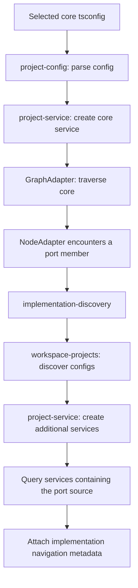

# flowLens

Implementation discovery searches TypeScript projects inside the nearest enclosing
Git root (including Git worktrees). Outside Git, it searches within the selected
config's directory. There is no workspace-root override. Graph traversal still
uses the selected project; discovered implementations are navigation targets and
do not add adapter bodies to the graph.

Each discovered project uses its own compiler settings and module resolution.
Discovery uses TypeScript's built-in source redirection for project references,
subject to `disableSourceOfProjectReferenceRedirect`. Declaration files and
`node_modules` are excluded from navigation. Invalid additional configs produce a
warning and partial discovery; an invalid selected config still fails.

Implementation lookup relies entirely on TypeScript. In particular, TypeScript
6.0.3 can return no implementation for a port composed from intersected mapped
types such as `ScopedReads<T> & ScopedWrites<T>`, even when a class explicitly
implements the port and is visible in a dependent project. Workspace visibility
and navigation therefore do not guarantee discovery for the complete Seyna
example. The two-project fixture in `packages/analyzer-core/src/fixtures/workspace`
characterizes this limitation alongside a working plain-port case. The existing
invoice integration fixture remains useful for same-project plain interfaces.

## Implementation discovery architecture

Graph traversal uses the selected project's program. Workspace implementation
searches add navigation metadata without traversing the discovered adapter bodies.

## Module resolution

Workspace packages resolve `@flowlens/*` imports through their public package
exports. Run `pnpm build` from the workspace root before starting an application
on a fresh checkout; this builds dependencies in workspace order. Start the CLI
from the workspace root (`pnpm --filter server start <entry-file>` or
`pnpm dev <entry-file>`) so its existing frontend-asset lookup finds the bundle.
Node packages
use NodeNext, while the Vite frontend retains bundler resolution and the VS Code
extension retains its CommonJS bundle.

Private imports are declared in each owning package's `package.json`:

- `code-insights`: `#domain/*` and `#common/*` resolve to `dist/**/*.js` by default.
  TypeScript maps these output paths back to source using `rootDir` and `outDir`.
  For source execution, run from that package with
  `node --conditions=development --loader ts-node/esm <source-entry.ts>`.
  The loader handles existing relative `.js` imports in TypeScript source.
- Frontend: `#store/*`, `#code-analysis-context/*`, and `#common/*` resolve to
  source files through Vite and TypeScript. Include the source extension (`.ts`
  or `.tsx`) and explicit `index.ts` for directory entry points, including in
  Vitest mocks. No alias resolver plugin is required.

Use package exports for imports across workspace package boundaries. Do not use
another package's private `#` imports. Build and ship each Node package's
`package.json` alongside its `dist` directory so Node and declaration consumers
can resolve its private imports.

The analyzer fixture at `packages/analyzer-core/src/fixtures/workspace` deliberately
retains `@fixture/core/*` TypeScript paths to test analysis of projects that use
that configuration.
